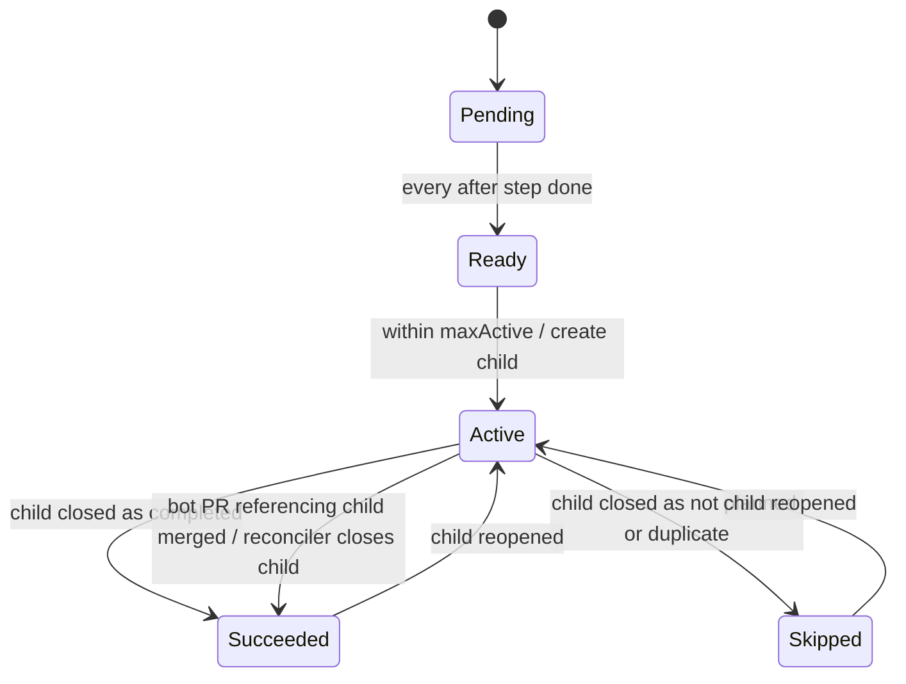
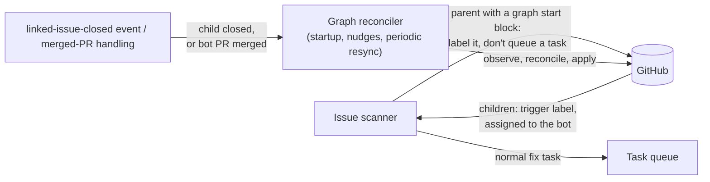

# Design Note: Issue Graphs (`IssueGraph`)

| Metadata | Details |
| :--- | :--- |
| **Status** | Proposal; not built. First written as *Deterministic Multi-Step Issue Pipelines* (`IssuePipeline`, #1841); revised as issue graphs: a pipeline is a graph whose steps each depend on the one before. Since #1841 the watch's decisions moved to the rules engine ([watch-rules.md](watch-rules.md)) and [fan-out](fanout.md) shipped, so the reconciler sits beside `watch/fanouts`, and parents are kept from `fix`/`workflow` by a fact, as `fanout: false` does for fan-out parents. Issues are now planned and implemented through `.agents` rules and recipes (#2119, #2120), which gives graphs a second source of steps: a plan's breakdown. |
| **Author(s)** | Sam Dowell (`sdowell@google.com`); revised for DAGs, plans and nesting |
| **Created** | 2026-09-29 |
| **Last Updated** | 2026-10-25 |
| **Replaces** | [`.agents/workflows/kcc-greenfield.txt`](../../.agents/workflows/kcc-greenfield.txt) (LLM-driven `mode: workflow`) |
| **Related** | [workflow-orchestration-and-session-reconciliation.md](workflow-orchestration-and-session-reconciliation.md), [watch-subcontrollers-architecture.md](watch-subcontrollers-architecture.md), [task-recipes-and-outputs.md](task-recipes-and-outputs.md), [fanout.md](fanout.md), [watch-rules.md](watch-rules.md) |
| **Scope** | `factory watch`, `factory` CLI, `.agents/` rules and recipes |

---

## 1. Summary

Add a declarative **`IssueGraph`**: a set of steps, each a templated GitHub issue, with `after` edges between them (a DAG). A new deterministic graph reconciler in `factory watch`:

1. Opens a step as a **sub-issue** of a parent issue once every step it depends on is done, at most `maxActive` at a time.
2. Waits until those children are **closed**.
3. Opens the steps that are now ready.
4. Closes the parent after the last step.

A pipeline is the special case where each step depends on the one before.

Orchestration needs no sandbox, LLM session, journal branch or precondition script. Child issues are ordinary trigger-labelled issues, and they go through the existing flow: the `fix` rule, then the PR rules (`comments`, `conflict`, `ci`, `review`, `ready`).

Steps come from one of two sources: a **template** defined **only in the repository it runs against** (the latest definition on the default branch is always used), or an issue's **approved plan** - the breakdown in its plan comment (§4.5).

Each step says what its child does first: be fixed, be planned, or wait for a person (`then`, §4.6). A child that is planned and broken down becomes the parent of its own graph, so graphs nest (§4.7).

---

## 2. Problems with the current approach

[kcc-greenfield.txt](../../.agents/workflows/kcc-greenfield.txt) asks an LLM to act as a state machine:

| Concern | Today (LLM workflow) | Cost |
| :--- | :--- | :--- |
| Sequencing | LLM reads a journal and decides "next step?" | Can skip or repeat steps |
| Idempotency | Prompt tells the LLM to search before creating | Duplicate child issues when the LLM forgets or search lags |
| State | Markdown journal pushed to a git branch | Rebase-and-retry loops; state drifts from GitHub |
| Progress UI | LLM hand-writes a table into the parent | Inconsistent format; chatty updates |
| Gating | Precondition script, related-issue list and cooldown | Bash duplicated per workflow |
| Safety | Long "do NOT…" guardrail list | Guardrails only work if the LLM follows them |
| Cost | Sandbox + LLM tokens on every run, including "still waiting" | Wasted compute and tokens |

Latency is no longer the main problem: the `nudge` rule already steps a workflow when an issue it links closes. What remains is determinism, idempotency and cost. On KCC staging, most of the ~150 workflow runs every 3 hours are an orchestrator waking a suspended sandbox to check on its children, and under cluster pressure those wakes fail (two on 2026-10-25, on `FailedScheduling` and `FailedAttachVolume`).

Plans have a related gap: `overseer/implement` turns an approved plan into one fix PR (#2120), but a plan whose work needs several PRs, some depending on others, has nowhere to go. The orchestration needs no judgement. It is a fixed state machine over GitHub issue state, so it should be code.

---

## 3. Goals / Non-Goals

**Goals**
* Declare a multi-step flow as one YAML file in the repository it runs against, or as an approved plan's breakdown.
* Deterministic, idempotent, level-triggered reconciliation: the same definition and GitHub state always give the same actions.
* Each step becomes a sub-issue. A step's child is created only after every step it depends on is closed, and at most `maxActive` steps are active at a time (default 1).
* Each child's first move (`then: fix | plan | ask`) is set by the planner and can be overridden by a person.
* Graphs nest: a child can be planned and broken down into its own graph, up to a depth limit.
* GitHub is the only state store. Nothing in the daemon has to survive a restart.
* The next child is created within one resync interval of the previous child closing, sooner when a nudge arrives.
* The decision logic is a pure function that can be table-tested.

**Non-Goals (v1)**
* Fan-out (repeating a step once per value of a list) and conditional steps. The design leaves room for these (§14).
* Dependencies across levels of a nested graph: a step depends only on its siblings.
* Templates defined outside the watched repository, or pinned to a definition version.
* Replacing LLM-driven workflows that need judgement (for example `kcc-direct-migration-tracker`).
* Changing how child issues are worked on.

---

## 4. Defining a graph

### 4.1 Definition file (`.agents/graphs/<name>.yaml`)

```yaml
apiVersion: factory.gemini.google.com/v1alpha1
kind: IssueGraph
metadata:
  name: kcc-greenfield
  description: >-
    Drive a KCC greenfield resource to a production-ready direct
    controller.
spec:
  # Inputs supplied by the parent issue.
  params:
    - name: kind
      description: CamelCase KCC Kind
      pattern: '^[A-Z][A-Za-z0-9]{1,62}$'
      example: SpannerInstanceConfig
    - name: version
      description: API version to generate
      required: false
      enum: [v1alpha1, v1beta1]
      default: v1alpha1

  # How many steps may be active at once (default 1).
  maxActive: 1

  # Applied to every step unless the step overrides it.
  defaults:
    labels: [greenfield]     # the deployment's trigger label is always added

  steps:
    - id: gen-types
      title: 'Greenfield: Implement direct KRM types, identity, and generate.sh for {{ .Params.kind }}'
      labels: [step/gen-types]
      review: |
        Check that the types follow the KRM API conventions and that the
        output of generate.sh is committed.
      body: |
        Please follow the skill `.gemini/skills/kcc-direct-greenfield-types-implementer/SKILL.md` ...
        Generate the types at `{{ .Params.version }}`.

    - id: controller
      after: [gen-types]
      title: 'Greenfield: Implement direct controller, E2E fixtures, and fuzzer for {{ .Params.kind }}'
      labels: [step/controller]
      review: |
        Check that the E2E fixtures cover create, update and delete.
      body: |
        ...
        The types were added in #{{ (step "gen-types").Issue }}.

    - id: mockgcp
      after: [controller]
      title: 'Greenfield: Implement MockGCP and Alignment for {{ .Params.kind }}'
      body: |
        ...

    - id: mockgcp-alignment
      after: [mockgcp]
      title: 'Greenfield: Align MockGCP logs with RealGCP for {{ .Params.kind }}'
      body: |
        ...
```

`apiVersion`/`kind` is a versioned schema header, **not** a Kubernetes resource. It lets the format evolve and lets tools recognise a graph file. A chain of `after` is a pipeline; steps that do not depend on each other may run side by side, within `maxActive`.

### 4.2 Schema

| Field | Meaning |
| :--- | :--- |
| `params[]` | Inputs from the parent issue. Each must have a `pattern` or an `enum`, so free text never reaches a template. Values are strings in v1. |
| `params[].required` | Defaults to `true`. An optional param (`required: false`) may be left out of the parent's block. |
| `params[].default` | Only allowed on optional params, and must satisfy the param's constraint. An omitted optional param takes its `default`, or the empty string if it has none, so templates can test it with `{{ if .Params.<name> }}`. |
| `steps[].id` | Unique, stable identity. Children are matched to steps by `id`, never by position or title. |
| `title` / `body` | Templates. They can use `.Params`, a few string helpers, and `step "<id>"`, which gives the issue number and URL of a step this one depends on, directly or not. |
| `labels` | Added to `defaults.labels`. The deployment's trigger label is always added; definitions never name it. |
| `review` | Optional review instructions (a template). When set, the child's PR goes through [automated review](pr-automated-review.md): the reconciler adds the review label (`<triggerLabel>/review`) to the child and appends the rendered text to the child body under a `## Review Instructions` heading. The PR inherits both from the child it references, as described in pr-automated-review.md. When omitted, the PR is not reviewed automatically. |
| `assignees` | Optional. Defaults to the watch's target assignee, so the child is picked up quickly. |
| `after` | Step ids that must be done before this step's child is created. They must form a DAG: unknown ids and cycles are invalid. A step without `after` is ready at once. |
| `finally` | Optional: one step (`title`, `body`, `then`, `labels`, `review`), created once every other step is done, with no `after` to keep up to date. The parent closes when it is done. Without it, the parent closes when the steps are done. |
| `maxActive` | How many steps may be active at once. Default 1. |
| `then` | What the child does first: `fix` (default), `plan` or `ask` (§4.6). |
| `checkpoint` | `stop`, `replan` or both: when the step is done, the reconciler stops the graph, has the plan revised, or both (§4.8). |

A child closed as not planned or as a duplicate is treated as done: its step is `Skipped` and the graph moves on (§5.5). To stop a graph instead, add the stop label to the parent or close it.

When the last step is done, the reconciler always closes the parent as completed (§6.1).

### 4.3 Starting a graph from a parent issue

The parent issue body contains one fenced block:

````markdown
Onboard SpannerInstanceConfig as a greenfield resource.

```factory-graph
graph: kcc-greenfield
params:
  kind: SpannerInstanceConfig
```
````

For a planned issue, the steps come from its plan instead (§4.5):

````markdown
```factory-graph
source: plan
```
````

The block is read from the parent's body, or from a keyed comment (`<!-- factory:comment key=graph v=N -->`) by a trusted author: one of the author kinds `pool`, `owner`, `member`, `collaborator`, as the `keyed-comment` recipe step reads them. The bot cannot edit another account's issue body, so a rule starts a graph by posting that comment (`overseer/breakdown`, §4.5).

* `graph:` is a bare name, resolved to `.agents/graphs/<name>.yaml` in the watched repository. Paths, URLs and other repositories are rejected, so a graph can only create issues in the repository that defines it.
* `params:` must include every required param and may include optional ones. Unknown params are rejected.
* The parent must be an issue the watch already acts on (trigger-labelled or assigned to a bot), which needs at least triage access.
* Existing issues are bound to steps by an operator (`factory graph adopt`, §9), never from the issue body.

### 4.4 Validation

`factory graph validate` is suitable for CI. It checks:
* that the schema is strict, with no unknown fields;
* that step ids are unique, and `after` names existing steps without a cycle (`finally` has no `after`);
* that every param is constrained;
* that every `default` is on an optional param and satisfies its constraint;
* that templates parse and only reference steps they depend on.

It then renders every step with each param's `example`, and again with every optional param omitted.

The reconciler runs the same checks against the parent's actual params, or the plan's steps, before it creates anything.

### 4.5 Steps from a plan

The plan recipe (`.agents/recipes/plan.yaml`) writes an issue's plan comment (key `plan`, refined in place: v1, v2, ...). When the work is bigger than one reviewable PR, the plan ends with a **Breakdown**: prose for people, and a fenced block in the step schema of §4.2, without params:

````markdown
## Breakdown
1. **schema** - the versioned schema package.
2. **recorder** - the event recorder (after schema); big enough to plan on its own.
3. **compare** - threshold compare (after recorder).

```yaml graph
maxActive: 2
steps:
  - id: schema
    title: Add the versioned schema package
    body: |
      ...
  - id: recorder
    after: [schema]
    then: plan
    title: Streaming event recorder and shard merge
    body: |
      ...
  - id: compare
    after: [recorder]
    title: Threshold compare and stats.jsonl
    body: |
      ...
finally:
  title: Wire it into the CLI and document
  body: |
    ...
```
````

* `source: plan` reads the newest comment of key `plan` by `pool`, `owner`, `member` or `collaborator`; anyone else's carrying the marker is ignored. A plan without a `graph` block is `Invalid` as a graph source: it is a one-PR plan, which `overseer/implement` implements (#2120).
* The steps are read fresh every pass, as a template is: a plan refined after the graph started changes the steps not yet started.
* The rules in `.agents/watch/` tie it together:

| Label | Rule | What happens |
| :--- | :--- | :--- |
| `<trigger>/plan` | `plan` | The plan comment is posted or updated, with a Breakdown when the work needs more than one PR; the watcher adds `<trigger>/planned`. |
| `<trigger>/implement` | `implement` | Approval of a one-PR plan: fix-with-plan opens the PR (#2120). |
| `<trigger>/breakdown` | `breakdown` (new) | Approval of a plan with a Breakdown: a recipe with no agent validates the `graph` block and posts the start block `source: plan` as a keyed comment. The reconciler takes it from there. |
| `<trigger>` on a planned issue | `fix` | Nothing: fix leaves an issue in the plan flow alone (#2120). |

### 4.6 What each child does first (`then`)

| `then` | The child is created with | So |
| :--- | :--- | :--- |
| `fix` (default) | the trigger label, `labels` and the review label | the `fix` rule implements it; the PR rules care for its PR. |
| `plan` | `<trigger>/plan` | the `plan` rule plans it; a maintainer approves with `<trigger>/implement` (one PR) or `<trigger>/breakdown` (its own graph, §4.7). |
| `ask` | `<trigger>/route` | nothing runs until a person applies the trigger label (fix) or `<trigger>/plan`. |

The planner proposes `then` for each step and a maintainer approves it with the plan. Until a child starts, anyone with triage access can override its route by changing its labels; later, a triage rule on `<trigger>/route` children could choose.

### 4.7 Nesting

A child that is planned and broken down gets its own start block and becomes a parent. Its graph is reconciled like any other, one level down:

```
#100 --plan--> breakdown: A, B (after A, then: plan), C (after A)
  |- A  #101 --fix--> PR merged: A done
  |- B  #102 --plan--> breakdown: B1, B2 (after B1)     <- #102 is a parent too
  |     |- B1 #110 --fix--> PR merged
  |     '- B2 #111 --fix--> PR merged: #102's graph done, #102 closed: B done
  '- C  #103 --fix--> PR merged: C done
#100's graph done: #100 closed
```

* **Completion bubbles up.** A graph that finishes closes its parent as completed (§6.1). One level up, that parent is a child, so its step is done. No level reads another level's graph.
* **Depth.** Each child's marker records its depth. A start block on an issue at `maxDepth` (default 3, an overseer setting) is `Invalid`: deeper splits take a person filing a new issue.
* **Dependencies stay within a level.** A step depends only on its siblings; anything else is said one level up, so each graph stays acyclic.

### 4.8 Replanning

A plan can change as its steps finish: what one step taught can change the ones still to come. Replanning is `<trigger>/plan` on the parent - the same label and the same `plan` rule that wrote the plan:

* **A person** applies it at any time.
* **The reconciler** applies it at a checkpoint (below).

#### Checkpoints

A step can be a **checkpoint**: when it is done, the reconciler pauses the graph, has the plan revised, or both, as [fan-out](fanout.md)'s checkpoints stop a fan-out for people to look:

```yaml
- id: recorder
  after: [schema]
  checkpoint: [replan, stop]   # stop | replan | [replan, stop]
```

| `checkpoint` | When the step is done |
| :--- | :--- |
| `stop` | The reconciler adds the stop label to the parent: the graph is `Paused` (no new children; the status still updates). Removing the label resumes it. |
| `replan` | The reconciler adds `<trigger>/plan` to the parent: the plan is revised (below), and the next pass follows it. |
| `[replan, stop]` | Both: the plan is revised and the graph holds until a maintainer has read the new version and removes the stop label - the approval of a replan. |

Each checkpoint fires once: it is recorded in the status comment's state, so removing the stop label, or a later pass, does not trip it again. The reconciler only adds labels; the plan rule does the replanning and takes `<trigger>/plan` off when it is done. Children already open when a checkpoint stops the graph go on (stop each to pause it).

On a replan, the plan recipe revises the plan comment (the next version) knowing what happened: the graph's status comment (`key=graph-status`: each step's state, child and PR) and the done children's PRs. Done and active steps keep their ids and stay as they are; steps not yet started can change, be added or be removed, and so can `finally`; the plan says what changed and why.

The next pass reads the new version, as it reads a refined plan: steps not yet started follow it, active children run on, and a step removed after its child exists shows as orphaned. A revision that changes or drops a done or active step is not applied; the status says so, for a maintainer to fix.

---

## 5. State model: GitHub is the database

The reconciler keeps no state of its own. Each cycle it reads everything it needs from GitHub:

| Artifact | Purpose |
| :--- | :--- |
| **Sub-issue link** (parent → child) | Discovers children and gives native nesting in the GitHub UI. |
| **Hidden marker in each child body** | Names the parent, the source (template or `plan`), the step and the depth, plus a hash of the params the parent supplied when the child was rendered. |
| **Status comment on the parent** | Human-readable progress (§8): a keyed comment (`key=graph-status`) the watcher edits in place. Output only; apart from the completion marker, never read back as state. |
| **Completion marker** | A hidden marker in the status comment, recording that the graph finished, so completion happens exactly once. |

Child bodies don't mention the parent as `#N`. The sub-issue link already shows the relationship, and leaving the reference out makes it less likely that an agent writes `Fixes #<parent>` (§6.3).

### 5.1 Matching children to steps

A step's children are the issues whose marker names this parent and step. For each step:

* The **canonical child** is the oldest open child, or the newest closed child if none is open.
* Any other open children are duplicates, and they are closed as duplicates of the canonical one.

Sub-issues without a valid marker are left alone and listed in the status as unmanaged.

### 5.2 Creating children without duplicates

Creating a child and linking it to the parent are separate operations as far as GitHub guarantees, and the daemon can crash in between. Each cycle, the reconciler therefore also looks at the issues it recently created itself. Any marked issue that isn't yet linked gets linked instead of being created again. This lookup uses the repository's issue listing, not the eventually consistent search index.

### 5.3 Labels and assignees

Without push access, labels and assignees set when an issue is created are silently dropped. The reconciler applies them after creation, checks that they took, and re-applies them every cycle while the child is open. Persistent failures show up in the status comment.

### 5.4 Params can't change after start

Each child records a hash of the params the parent supplied. If someone edits the parent so the params no longer match, the graph is **Blocked** until they are restored. To run with different params, file a new parent. This stops a body edit from changing what the remaining steps ask agents to do. Only the supplied params are frozen; the definition, including defaults for omitted optional params, is still read fresh (§11).

### 5.5 States

Each step follows this state machine:



A step is **done** when it is `Succeeded` or `Skipped`. A child that became a parent is `Active` until its own graph closes it. The `finally` step is `Pending` until every other step is done, then `Ready`.

The graph's phase is derived from the steps and the parent:

| Phase | Meaning |
| :--- | :--- |
| `Running` | A step is active or ready. |
| `Blocked` | Params changed after start. |
| `Paused` | The parent has the stop label. |
| `Succeeded` | Every step is done. |
| `Cancelled` | A person closed the parent. |
| `Invalid` | The definition, the plan's steps, the params or the depth failed validation. |

---

## 6. Reconciliation

The design separates **deciding** from **doing**:

* **Reconcile** takes the definition, params and observed GitHub state, and returns a status and a list of actions. It does no I/O and reads no clock, so it is deterministic and table-testable.
* An **executor** applies the actions. Every action is safe to repeat. A failure ends the cycle, and the next cycle observes again and continues.

### 6.1 Algorithm

1. **Parent closed.** If a PR or commit closed it while steps remain, reopen it with a comment. If a person closed it, the phase is `Cancelled`. If the graph already completed, do nothing.
2. **Stop label.** The phase is `Paused`; only the status is updated.
3. **Invalid** definition or params. Label the parent and report it in the status; create nothing.
4. **Params changed** after start. The phase is `Blocked`; create nothing.
5. **Repair.** Link marked children that aren't yet linked (§5.2), and close duplicates (§5.1).
6. **Active child.** Re-apply missing labels and assignees. Close the child as completed if a bot PR that references it has merged (§6.3); always on, with no per-step setting: a step that needs several PRs is a child with `then: plan` that breaks down into its own steps.
7. **Checkpoints.** For each checkpoint step that is done and not yet recorded, add the stop label and/or `<trigger>/plan` to the parent, and record it (§4.8). A stop added here ends the pass: the graph is `Paused` from the next one.
8. **Create.** For each ready step in definition order, while fewer than `maxActive` steps are active, create its child with the labels its `then` gives (§4.6).
9. **Complete.** When every step, and the `finally` step if there is one, is done and the parent isn't marked complete, write the completion marker and close the parent as completed. No completion comment is posted; the final status comment shows the result. Completion is final; a parent reopened afterwards is left alone. A nested parent closing completes its step one level up (§4.7).
10. **Status.** Update the status comment if, and only if, its content changed.

There are at most `maxActive` active steps, and at most one create per step per cycle. A step added to the definition runs once the steps it depends on are done.

### 6.2 Applying actions

* The executor applies actions in order, and checks that writes such as labels actually took (§5.3).
* The status comment is found by its marker **and** by the reconciler's own identity, so other users' comments are never edited.
* At startup the executor checks its identity and repository permissions, and warns if writes may be limited.

### 6.3 Completion signal and the `Fixes #N` dependency

A step advances when its child closes. Usually the child's PR closes it as completed with `Fixes #N`. That line is written by an LLM, so it can be missing, or it can point at the wrong issue:

* **Missing `Fixes #N`.** When a bot PR that references the open child merges, the reconciler closes the child as completed and names the PR. It hears about the merge through the existing merged-PR handling, and it checks again on resync in case that signal was missed. Only bot-authored PRs count, so an unrelated PR that merely mentions the child can't complete it.
* **`Fixes #<parent>`.** If a PR or commit closes the parent while steps remain, the reconciler reopens it (§6.1).
* **Follow-up outside this design:** check for `Fixes #N` in code instead of relying on the prompt.

---

## 7. Running in `factory watch`

### 7.1 Components

The reconciler is a new subcontroller in the [subcontroller architecture](watch-subcontrollers-architecture.md):



* **Issue scanner and rules.** An issue with a `factory-graph` start block is routed to the graph reconciler and is never queued as a task or treated as a workflow: the scanner records it as a fact, and the `fix` and `workflow` rules exclude it (`graph: false`), as they exclude fan-out parents with `fanout: false`.
* **Graph reconciler** (`watch/graphs`). It reconciles at startup, on nudges and on a periodic resync. Each pass covers open graph parents, plus recently closed ones so that accidental closes are caught. It never touches the task queue or sandboxes.
* **Children.** Children are ordinary issues routed by the labels their `then` gives (§4.6), so the existing rules pick them up.
* **Single writer.** Only one reconciler per repository writes. Others run in dry-run mode. The mechanism (for example, a Kubernetes `Lease`) is an implementation choice. Graphs are behind a flag during rollout.
* **Overseer.** If the Overseer runs `factory watch` in time-boxed windows, the startup pass means every window makes progress.

### 7.2 Nudges

When a graph child closes, the sandbox GC's closed-issue hook (the `linked-issue-closed` event the `nudge` rule acts on, and that already wakes a fan-out parent) triggers the reconciler for the child's parent instead of stepping a workflow. A nested parent closing wakes the level above the same way. Nudges can be missed, so the periodic resync stays as the backstop.

### 7.3 Identity

The reconciler writes as the watch daemon's GitHub identity. In-cluster that is the bot. A local run writes as whoever runs it, so local use should normally stick to `--dry-run` or use a bot token. If the identity changes, a new status comment is posted.

### 7.4 API cost

Each pass makes a few repository-wide listings, plus one sub-issue read per parent that changed since the last pass, plus any writes. Parents with no changes are skipped, and a periodic full pass guards against stale skips. Nothing is cached across restarts.

---

## 8. Parent status

A single comment on the parent, edited in place, replaces the hand-written progress table:

```markdown
### Graph `kcc-greenfield` — SpannerInstanceConfig
**Phase:** Running · **Current step:** 2/4 `controller`

| # | Step | Issue | State | Started | Completed |
|---|------|-------|-------|---------|-----------|
| 1 | gen-types | #10812 | ✅ Succeeded | 2026-09-20 | 2026-09-24 |
| 2 | controller | #10901 | 🔄 Active | 2026-09-24 | |
| 3 | mockgcp | — | ⏳ Pending | | |
| 4 | mockgcp-alignment | — | ⏳ Pending | | |

> ⚠️ #10901 is missing label `factory`: re-adding failed (permission denied)

<sub>definition: .agents/graphs/kcc-greenfield.yaml@a1b2c3d</sub>
```

* It is rendered purely from the definition and observed state, with no timestamps of its own, so it changes only when something real changes.
* Skipped steps are shown as `⏭️ Skipped`, with a link to the closed child.
* Warnings cover missing labels, closed duplicates, changed params, unmanaged sub-issues and orphaned steps.
* A child that is itself a graph parent shows its own progress, read from its status comment.
* It is a comment rather than the issue body because the reconciler can always edit its own comment, while editing someone else's body can fail.

---

## 9. CLI surface

| Command | Purpose |
| :--- | :--- |
| `factory graph validate <file>` | Static checks (§4.4); CI-friendly. Writes nothing. With `--url <issue>`, the same on an issue's plan `graph` block. |
| `factory graph reconcile --url <parent> [--dry-run]` | One-shot reconcile. (`factory fix` is gone, #1884; `factory recipe fix` on a parent would route here.) |
| `factory graph adopt --url <parent> --step <id> --issue <n> [--dry-run]` | Bind an existing issue to a step: add the marker and link it as a sub-issue. |

**Dry-run mode.** Every command that writes to GitHub accepts `--dry-run`. It runs the same observe and reconcile code as a real run, then prints the rendered status and the actions the executor would apply, instead of applying them. Its output is therefore exactly what a real run would do at that moment, which makes it the way to preview a new or edited definition against a real parent. `factory watch` has the same mode (§13).

---

## 10. Moving kcc-greenfield to a graph

Existing kcc-greenfield parents are **not** migrated. New parents use the graph template, and in-flight ones finish on the old workflow.

1. Commit `.agents/graphs/kcc-greenfield.yaml` to the KCC repository. Step bodies copy over almost verbatim, with placeholders becoming template params and the step order becoming `after`. The review label becomes a `review` field holding the reviewer's instructions. The precondition script, cooldown, journal, guardrails and "search before create" instructions aren't carried over.
2. File new greenfield parents with a `factory-graph` block instead of the workflow reference.
3. Leave in-flight parents on `kcc-greenfield.txt` until they finish. The two don't interfere: a parent is handled as a graph only if it has a `factory-graph` start block. The workflow rules, including the pinned `workflow-missing`, are unchanged.
4. Delete `kcc-greenfield.txt` once no open parent references it.

---

## 11. Edge cases

| Case | Behaviour |
| :--- | :--- |
| Definition edited mid-flight | The latest definition is used. Existing children are never edited. New or changed steps take effect when they come up. Removed steps that have children show as orphaned. |
| Step added ahead of a started step | Runs once the steps it depends on are done. |
| Cycle or unknown `after` | `Invalid`; nothing is created. |
| A step added after `finally` started | Created as usual; the parent closes only when it and `finally` are both done. |
| Several steps ready, `maxActive` reached | Created in definition order as active ones finish. |
| Plan refined after the graph started | Steps not yet started follow the new version; existing children are never edited. |
| A replan changes or drops a done or active step | Not applied; the status warns, and the graph keeps the last version that kept them. |
| A checkpoint reached while a plan run is queued or running | The label is already there: one replan covers it. |
| A plan comment by someone outside the trusted author kinds | Ignored; a parent with only such a plan is `Invalid`. |
| Child that became a graph parent | `Active` until its own graph closes it. |
| Start block on an issue at `maxDepth` | `Invalid` for that issue's graph; the level above is unaffected. |
| Child reopened | Its step goes back to `Active`; steps depending on it that have not started wait again. |
| Several open children for one step | The oldest is kept; the others are closed as duplicates. |
| Child closed as not planned or duplicate | The step is `Skipped`, and the next step starts. |
| Optional param omitted | Takes its current `default` from the definition, or the empty string. |
| Required param missing, or unknown param supplied | `Invalid`. |
| Parent closed by a person | `Cancelled`. Open children are left open. |
| Parent closed by a PR or commit with steps remaining | Reopened with a comment. |
| Parent reopened after completion | Left open; completion isn't repeated. |
| Stop label on the parent | `Paused`. The status still updates. |
| Params changed after start | `Blocked` until restored. |
| Invalid definition or params, or file not found | `Invalid`: the parent is labelled, the status explains why, nothing is created. |
| Transient GitHub errors | That parent is retried next pass. It is not marked `Invalid`. |
| Crash during or after a create | The next pass finds and links the child instead of creating another (§5.2). |
| Second watcher on the same repo | Dry-run (§7.1). |

---

## 12. Alternatives considered

| Alternative | Why not (for v1) |
| :--- | :--- |
| **Create every child upfront**, linked with GitHub's blocked-by dependencies | Freezes future steps at creation, which conflicts with always using the latest definition (or the latest plan). The scanner would also have to skip blocked issues. Blocked-by links could still be added later for display. |
| **Extend fan-out** with `after:` | Fan-out is one task over many items; a plan's steps are different tasks. A graph is the general form, and fan-out can become one of its sources (§14). |
| **A recipe that emits sub-issues** | One-shot: nothing would open the next steps, track progress or close the parent. |
| **GitHub Actions** in the target repo | Needs a workflow and a write token in every target repo, which factory doesn't control. Splits the logic and has no dry run. |
| **Kubernetes CRD** for graphs | The trigger is a GitHub issue, so the CR would only mirror GitHub state, and local runs would depend on a cluster. The schema header keeps this option open. |
| **Keep the LLM workflow** and make only the gating deterministic | Cheaper, but sequencing, idempotency and status would stay LLM-driven. |

---

## 13. Testing, rollout and observability

**Testing**
* Table tests for Reconcile, covering:
  * every state transition;
  * not-planned and duplicate children being skipped;
  * optional params, with and without defaults;
  * changed params;
  * duplicates;
  * parent closes (by a person vs. by a PR) and reopens;
  * PR-merge completion;
  * a step added ahead of a started step;
  * DAG readiness, `maxActive`, cycles and unknown ids;
  * `then` routing labels;
  * nesting: a child as parent, completion bubbling, the depth limit;
  * plan-source reads: trusted authors only, versions, steps added and removed;
  * checkpoints: `stop`, `replan` and both, each once per step (removing stop does not re-trip it); a revision that rewrites a done step refused.
* Executor tests against a fake GitHub, including partial failures and dropped labels.
* `validate` run in CI over `.agents/graphs/`.
* End to end on a scratch repository with a two-step graph, and a two-level graph from a plan, with real PR merges.

**Rollout**
1. Schema, `validate` and `reconcile --dry-run` (read-only).
2. Executor and one-shot `reconcile` (manual progression).
3. Reconciler in `factory watch`, behind a flag.
4. `after`, `maxActive` and `then` routing.
5. The plan source, the `breakdown` rule, nesting and the depth limit.
6. Start one new greenfield Kind on the graph template, then use it for all new Kinds and enable the flag by default. Delete `kcc-greenfield.txt` once in-flight parents finish.

**Observability**
* A journal entry for every action taken.
* Graph phase and step states exposed on the watch's local API.
* Dry-run mode that logs actions instead of writing them.
* Warnings for persistent write failures and for not being the single writer.

---

## 14. Future extensions

* **Fan-out.** Repeat a step once per value of a list param, with one sub-issue per value and a cap on how many are open at once. This overlaps with the separate, implemented [fan-out](fanout.md) (sub-issues under a parent, a progress comment, `overseer/stop` to hold), and issue graphs could be extended to supersede it, as another source of steps. v1 leaves room for this:
  * steps are identified by `id`, not position;
  * the child marker can carry an extra per-value key;
  * params can gain a list type;
  * the status comment can nest per-value rows under a step.
* **Gate steps**: wait on a label or approval without creating an issue.
* **Conditions** on params, and `skip-if`: a deterministic check at a step's turn that skips it.
* **One label for implement and breakdown**, choosing by whether the plan has a Breakdown.
* **Route by triage:** a rule that chooses `fix` or `plan` for `<trigger>/route` children.
* **Require a merged PR** for completion, if closed-as-completed proves too loose.
* **Blocked-by links** between children, for display.

---

## 15. Decisions

| Question | Decision |
| :--- | :--- |
| Pin the definition version? | **No.** Always use the latest definition on the default branch. |
| Where can definitions live? | **Only in the watched repository**, under `.agents/graphs/`, or in the parent's plan comment (`source: plan`). |
| Params source | An explicit `factory-graph` start block, in the parent's body or a keyed comment by a trusted author. Supplied params are frozen after start. |
| Completion signal | The child is closed as completed. As a backstop, a merged bot PR that references the child also completes it. |
| Child closed as not planned? | **Skip** the step and continue. No per-step policy or retry count in v1. |
| Parent on completion | Always closed as completed, with no completion comment. |
| Fan-out in v1? | **No.** Deferred; the design leaves room for it (§14). |
| Name | **Issue graph** (`IssueGraph`, `.agents/graphs/`, `factory-graph`, `factory graph`); a pipeline is a graph of chained steps. |
| Dependencies | `after` (a DAG) within a level, with `maxActive` (default 1), and an optional `finally` step after all the others. `dependsOn`, reserved in the pipeline design, is named `after`. |
| A child's first move | `then` (`fix`, `plan` or `ask`) per step, set by the planner, overridable by a person until the child starts. |
| Replanning | `<trigger>/plan` on the parent, by a person or by the reconciler at a `checkpoint: replan` step; the plan rule revises the plan, and the next pass follows it for steps not yet started. |
| Checkpoints | `checkpoint: stop`, `replan` or `[replan, stop]` per step, each firing once, as fan-out's checkpoints do; `[replan, stop]` holds the graph until a maintainer approves the revised plan by removing stop. |
| Nesting | A child can become a parent; depth recorded in markers, `maxDepth` default 3; completion bubbles up. |
