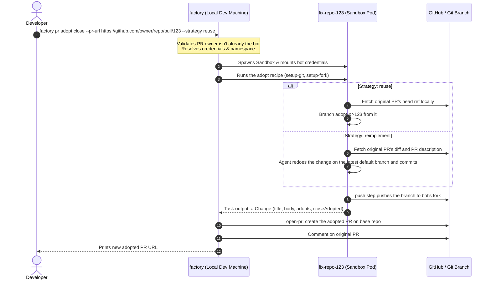

# Design Note: PR Adoption Workflows (Git-based & LLM-based)

This design note outlines the architecture and execution flow for adopting third-party Pull Requests under the onboarded factory-user identity.

**Status:** Implemented. `factory pr adopt` landed in #1105/#1123 as `adopt.sh` + `adopt.txt` run over envd; it now runs the `adopt` recipe (`factory/pkg/recipe/recipes/adopt.yaml`: #1908, one recipe with a `strategy` input #1911, task output #1912, input check after `setup-fork` #2050/#2052) and applies its `open-pr` action. The `--adopt` flags are gone; `factory pr` has only `watch` and `adopt`. The watch adopts no third-party PRs.

---

## Background & Problem Statement

When the `factory` is used in a collaborative repository, it needs to watch, iterate, or investigate PRs authored by external developers. However:
1. Standard user tokens/credentials do not have push access to external user forks.
2. If we try to push changes to the original author's fork branch, GitHub will reject the push with `permission denied`.
3. To work around this, we must "adopt" the PR first by forking the base repository under the factory-user's account, creating a new branch, pushing the commits there, creating a new PR from the bot's fork, and commenting/closing the original PR.
4. Performing git operations directly on the developer's local machine tries to use the developer's credentials rather than the bot credentials (which only reside in the Kubernetes namespace secret), resulting in permission failures.

Therefore, the adoption process **must execute entirely inside the sandbox environment** where the correct bot credentials are mounted and configured automatically.

---

## Architecture: Sandbox-Bound PR Adoption

`factory pr adopt` refuses a PR the adopting account already authored, then runs `factory recipe adopt` against the PR and applies the result's `open-pr` action. The recipe runs in the PR's fix sandbox (`fix-<repo>-<n>`); `open-pr` aliases that sandbox to the new PR, so the adopted PR's care runs there, on its branch.

Two adoption strategies (the recipe's `strategy` input):
1. **`reuse`**: A git-based approach that takes the original PR's head (`pull/<n>/head`) as branch `adopt-pr-<n>` on the factory-user's fork, preserving history and git authorship. No agent runs.
2. **`reimplement`**: The agent (the configured engine) redoes the change on branch `adopt-reimplement-pr-<n>` from the latest default branch, taking the original PR's title, description and diff as what the change does, and commits.

---

## Execution Flow



---

## CLI Command Interface

### `factory pr adopt`
```bash
factory pr adopt <open|close> --pr-url <url> [flags]
```

#### Positional Arguments
* `<open|close>` (Required): Specifies the post-adoption state action for the original PR.
  * `open`: Comments on the original PR linking to the new one, but leaves the original open.
  * `close`: Comments on the original PR, links to the new one, and closes the original PR.

#### Flags
* `--pr-url <string>` (Required): The URL of the incoming PR to adopt (e.g. `https://github.com/owner/repo/pull/123`).
* `--strategy <reuse|reimplement>` (String, default: `reuse`):
  * `reuse`: Direct git fetch/push (preserves commit history).
  * `reimplement`: Re-apply changes using LLM on the latest base branch.
* Standard Sandbox configuration flags (e.g., `--namespace`, `--secret-name`, `--workspace-disk-size`, `--image`, `--ephemeral-storage`).

The same run is `factory recipe adopt --url <PR> [--strategy reuse|reimplement] [--close true]`.

### No `--adopt` flag on other subcommands
The `--adopt` flag is gone (`factory pr iterate` and `factory pr investigate` are gone too). `factory pr watch` verifies ownership of the PR (`verifyPROwnership`) and errors out immediately if it does not belong to the factory user:
```
PR is not owned by the factory user (<login>). It is owned by <author>. Please run 'factory pr adopt <open|close> --pr-url <url>' to adopt it first
```

---

## Task Implementation Inside the Sandbox

The `adopt` recipe (`factory/pkg/recipe/recipes/adopt.yaml`) replaces the old `adopt` task (`adopt.sh`, `adopt.txt`):
* `setup-git` and `setup-fork` authenticate with the mounted bot token and make the checkout, `origin` the bot's fork and `upstream` the repository.
* `reuse`: fetches `pull/<n>/head` and checks out `adopt-pr-<n>`; the base is its merge base with the default branch.
* `reimplement`: `configure-engine` and `checkout-default-branch`, branch `adopt-reimplement-pr-<n>`, `gh pr diff` into `pr.diff`, then one `ask` with the PR's URL, title, description, diff and any `instructions`. The agent commits and never pushes; the prompt follows `--disclose` for attribution.
* A factory step writes `change.yaml` (`title: adopt: <title>`, body linking the original, `adopts`, `closeAdopted`), and `push` pushes the branch to the fork.
* The task output is a `Change` with `edit`, `open-pr` (Open adopted PR) and `reject` actions. `open-pr` opens the PR, comments on the original with a link, and closes it when `closeAdopted` is set.
