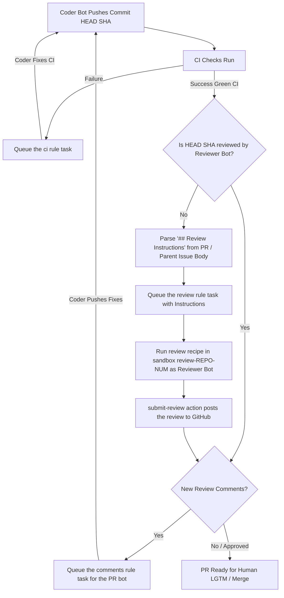

# Automated Pull Request Review Architecture & Design

This document describes the design, lifecycle, and identity model for automated AI Pull Request code reviews within the `factory watch` orchestration daemon.

**Status:** Implemented. Opt-in review, `## Review Instructions` and the reviewer role are built; since #1873 the review runs the `review` recipe and submits through its `submit-review` action (the classic `factory pr review` was deleted in #1874). Whether a PR is reviewed, and whether it is ready for humans, is decided by the watch rules engine: `factory/pkg/watch/rules/review.yaml`, `ready.yaml` and `ready-unreview.yaml` (Phase 4 B1 #2053, B2 #2055; see [watch-rules.md](watch-rules.md)). `ready-for-human` is permanent since #1597: it is never taken off again.

---

## 1. Overview & Motivation

Pull Requests created by automated workflows (such as migration checklists in `.agents/workflows/kcc-example.txt`) or standalone fix runs require rigorous, independent code review before human approval or merging.

Rather than coupling review lifecycle loops into individual workflow scripts, the AI Factory uses a **Watch-Driven Automated Review** model combined with **Markdown-Bounded Contextual Hints**:
- **Opt-In Triggering (`overseer/review`)**: To prevent reviewing too many PRs unnecessarily, automated AI review is gated on the presence of the `overseer/review` label (or `<triggerLabel>/review`) on either the PR or its referenced parent Issue. Once opted in, the PR receives a code review when CI passes on the current HEAD SHA (rule `review`).
- **Context-Aware Criteria (`## Review Instructions`)**: Workflows and PR authors can provide domain-specific review rules (such as `generate.sh` verification or round-trip fuzzer checklists) directly inside the PR description or its referenced parent Issue body.
- **Identity Isolation**: Reviews are executed in a dedicated Kubernetes Sandbox Pod under a distinct **Reviewer Bot** identity (`reviewbot-robot`), maintaining separation of duties from the Coder Bot (`lovelace-coder-bot`, etc.).

---

## 2. End-to-End Lifecycle Flow



---

## 3. Review Instructions Specification (`## Review Instructions`)

### A. Why Issue/PR Body Sections Over Labels
- **Universal Compatibility**: Many repositories restrict arbitrary labels or limit label creation permissions. Issue/PR Markdown descriptions work across all repositories.
- **Multi-Line & Structured**: Supports bulleted lists of files or raw text instructions without the 50-character limit of GitHub labels.
- **Inheritance**: If a PR references a parent Issue (`Fixes #123`, `Closes #123`), review instructions defined in the parent Issue are automatically inherited.

### B. Section Syntax & Parsing Rules
The helper `ExtractReviewInstructions` (`factory/pkg/commands/common/review_instructions.go`) parses Markdown content following these rules:

```markdown
## Review Instructions
- `.gemini/skills/generate-sh-checker/SKILL.md`
- Ensure all exported functions have GoDoc comments.
- `.gemini/skills/kcc-direct-controller-implementer/SKILL.md`

### Sub-notes for Reviewer
Pay special attention to field conversion accuracy.

## Next Section
```

1. **Header Discovery**: Matches any line starting with `#` through `######` followed by `Review Instructions` (case-insensitive). Records heading level $L$ (number of `#` characters).
2. **Multi-Line Span**: Reads all subsequent lines until it encounters any heading of equal or higher level (`#` up to $L$ `#`s). Sub-headings deeper than $L$ are retained inside the section.
3. **Path & Bullet Cleanup**: Strips Markdown list prefixes (`- `, `* `, `1. `) and enclosing backticks around paths (e.g. `` `.gemini/skills/foo/SKILL.md` `` $\rightarrow$ `.gemini/skills/foo/SKILL.md`).
4. **Resolution**:
   - If an instruction matches a file path in the repository, the review loads the file contents at `headSHA`.
   - If an instruction is plain text, it is treated as direct prompt instructions.

---

## 4. Execution Sandbox & Reviewer Identity

### Decision
The rule `review` (`factory/pkg/watch/rules/review.yaml`) decides the review: a PR of the bot pool's, CI green, no pending trusted feedback, not approved (`isPRApprovedOrLGTM`, `prs/labels.go`, is read as a fact), head not yet reviewed by the automated reviewer, and `*/review` on the PR, or on an issue it closes while the PR is not `ready-for-human`. It runs once per head (`dedupe: head`) and takes the PR after `comments`, `conflict` and `ci`. The PR scanner (`prs/scanner.go evaluate`) carries the decision out in `handlePRReview` (`prs/handlers.go`), which collects the review instructions and enqueues the `pr-rule` (`task-pr-<n>-rule-review`) task stamped with the rule's recipe (`review`) and apply (`submit-review`).

### A. Role Resolution (`selectUserForTask`)
When the dispatcher starts the review rule task, it routes execution through `selectUserForTask` (`factory/pkg/commands/watch/user_selection.go`):
```go
case taskType == api.TypePRReview:
    role = "reviewer"
```

### B. Configured Reviewer User (`FactoryConfig.Roles["reviewer"].Users`)
In the repository configuration (`overseer/examples/kcc.yaml`):
```yaml
roles:
  reviewer:
    users:
      - reviewbot-robot
  coder:
    users:
      - hopper-coder-bot
      - ada-coder-bot
      - neumann-coder-bot
      - lovelace-coder-bot
```
- `selectUserForTask` selects **`reviewbot-robot`** (or the repository's configured `reviewer` user pool).

### C. Pod Execution & API Identity
- The task runs `factory recipe review --apply --action submit-review` in the review recipe's own sandbox (`review-<repo>-<num>`, `api/recipe.go`) in the configured namespace.
- It mounts the onboarded Kubernetes secret for `reviewbot-robot`, containing that account's `GITHUB_TOKEN`.
- All inline review comments, approvals (`APPROVED`), and change requests (`CHANGES_REQUESTED`) posted to GitHub are authored by **`reviewbot-robot`**.

---

## 5. Ready-for-Human Signaling (`overseer/ready-for-human`)

Once a PR passes automated code review by the reviewer bot, the rule `ready` (`factory/pkg/watch/rules/ready.yaml`) applies the `overseer/ready-for-human` label (or `<triggerLabel>/ready-for-human`), drops `*/review`, assigns the closing issues' human assignees and unassigns the pool's bot. The rule `ready-unreview` drops a `*/review` that arrives on a PR that is already ready.

### A. Ready Conditions
The label is applied when all of the following conditions are met (and no task of the PR is running):
1. **Review Completed on HEAD (if enabled)**: If automated bot review is opted in via `overseer/review` (or inherited from parent issue), a configured reviewer bot must have completed its review on the latest `headSHA`. If automated review is not enabled, this prerequisite is automatically satisfied.
2. **Review Passed**: The latest review from the reviewer bot is not `CHANGES_REQUESTED` and all review feedback has been resolved (`!hasNewComments`).
3. **Passing CI Checks**: All GitHub check runs and commit statuses for `headSHA` are green (`!hasFailure`).
4. **Mergeable**: No merge conflicts or pending rebases (`!isConflicting`).
5. **Active & Open**: PR is open, not in draft mode, and not stopped (the stop label and closed state are code gates ahead of every rule).

### B. No Removal
The label is never removed (#1597): a ready PR that stops being ready keeps it. A human owns the PR from then on, and the bot's care rules still answer new feedback, conflicts and failing CI.

### C. Reviewer & Author Best Practices
Human reviewers and authors should wait for the `ready-for-human` label (or `<triggerLabel>/ready-for-human`) to be applied to a pull request before leaving review comments. If comments are added while the system is actively investigating CI check failures or resolving merge conflicts, subsequent automated commits pushed by the bot might render those comments outdated or cause them to be ignored. Waiting for the `ready-for-human` label ensures that the bot has finished all its automated cycles and is ready for human collaboration.

