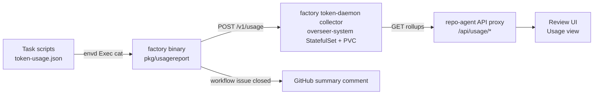

# Token Usage Collection Design Note

This document describes how gemini-cli token usage produced inside sandboxes is centrally collected, aggregated per issue/PR/workflow, surfaced in a dashboard, and summarized on GitHub.

---

## 1. Overview & Goals

Every task script accumulates gemini-cli stats into `<taskDir>/token-usage.json` (and `llm-usage.json`) inside the sandbox PVC (see `record_gemini_usage` in `factory/pkg/tasks/*.sh`). That data was previously stranded: nothing read it, and sandbox cleanup destroyed it.

Goals:
* **Durability**: usage must survive sandbox and overseer pod deletion.
* **Aggregation**: tokens per issue/PR (across all its tasks) and per workflow (across all issues/PRs linked to the workflow).
* **Zero task risk**: reporting is best-effort and disabled by default; a task can never fail because of usage collection.
* **No cross-module coupling**: factory/overseer do not import repo-agent; the JSON wire format is the only contract. Both producer (`factory/pkg/usagereport`) and collector (`factory/pkg/tokenusage`) live in the factory module and share one set of types; overseer only carries the deployment manifests.

---

## 2. Architecture



* **Collector** (`factory/pkg/tokenusage`, run as the hidden `factory token-daemon` command): plain net/http service storing records in a JSONL append log on a PVC (`records.jsonl`), with a full in-memory index rebuilt by replay at startup. Deployed by `overseer/k8s/token-usage.yaml` as Service + StatefulSet `token-usage` in `overseer-system`, reusing the overseer image (which bundles the factory binary) with `command: ["factory", "token-daemon"]` — no separate image to manage.
* **Producer** (`factory/pkg/usagereport`): reads usage files over envd (`cat <taskDir>/token-usage.json || cat <taskDir>/llm-usage.json`) and POSTs a `UsageRecord` to `$COLLECTOR_URL`. No-op when `COLLECTOR_URL` is unset; failures only log warnings.
* **Wiring**: the overseer controller injects `COLLECTOR_URL` (default `http://token-usage.overseer-system.svc.cluster.local:8080`) into overseer sandboxes; `factory watch` and its re-exec'd subcommands inherit it.

---

## 3. Usage Records & Idempotency

Each record carries context for aggregation plus the stats payload:

```json
{
  "key": "<sandbox>:<taskDir>",
  "repo": "owner/name",
  "taskType": "fix|review|investigate|address|iterate|adopt|agent",
  "taskDir": "/workspaces/tasks/fix-...", "sandbox": "fix-repo-42",
  "issue": 42, "pr": 101, "issues": [42],
  "workflow": "issue-42", "workflowName": "greenfield",
  "recordedAt": "RFC3339",
  "stats": {"models": {"<model>": {"api": {...}, "tokens": {...}}}}
}
```

The `key` is the idempotency key: re-posting upserts (append to the log; last line wins on replay). This makes the double-harvest strategy below safe.

---

## 4. Harvest Strategy: Push + Sweep

1. **Push (rich context)**: each command harvests right after its task completes — `fix.go` (issue + created PR), `pr.go` investigate/address-comments/iterate/adopt (PR + issues referenced by the PR via `getReferencedIssues`), `review.go` (PR), `agent.go` (workflow session/name, issue parsed from `issue-N`, created PR).
2. **Sweep (safety net)**: the watch-loop cleanup functions (`cleanupClosedPRSandboxes`, `cleanupClosedIssueSandboxes`, `cleanupStaleIdleSandboxes`) call `HarvestSandbox` immediately before `DeleteSandbox`, listing all `/workspaces/tasks/*/` dirs and harvesting each. Context is recovered from sandbox labels (`factory.gemini.google.com/pr`, `factory.gemini.google.com/workflow`) and the `wf-issue-N` naming convention. This catches detached, crashed, or timed-out tasks whose push hook never ran.

---

## 5. Rollups

The three rollups are **mutually exclusive** — every record is counted in exactly one, matching the sandbox categories shown in the dashboard:

* **Per workflow** ("Workflow Issues"): group by `workflow` session; a session `issue-N` also absorbs untagged records that reference issue N, so PR tasks spawned by a workflow count toward it.
* **Per issue** ("Issue / PR sandboxes"): remaining records count toward issue N if `issue == N` or N is in `issues` — the issue sandbox plus any PR work it led to. Rows with linked PRs are labeled `#N / PR #M`. Issues owned by a workflow session are excluded.
* **Per PR** ("PR sandboxes"): what is left — standalone PR work (reviews, investigations, adoptions) with no issue or workflow linkage.

All rollup list responses include the per-task `records` (with `taskType`, `sandbox`, and `recordedAt`) for drill-down in the dashboard.

Two additions on top of the record rollups:

* **Daily usage** (`GET /v1/usage/rollups/daily`): records grouped by the UTC day of `recordedAt`. `recordedAt` is stamped when a task's usage is **first** pushed and preserved across upserts (a later sweep re-post cannot move usage to a different day).
* **Subjects** (`POST /v1/subjects`, stored in `subjects.jsonl`): GitHub metadata of the entity usage is attributed to — `issue-<n>` / `pr-<n>` keys with `state` (open/closed), `createdAt`, and `closedAt`. Producers upsert subjects from the task hooks (open state, creation time) and from the watch-loop cleanup functions (closed state, close time); merge semantics never let an empty field blank out a known value. Rollups join on the subject key so the dashboard can show open/closed status and age (creation→close, or creation→now while open).

Endpoints: `GET /v1/usage/rollups/{issues,prs,workflows}[?repo=]` and `GET /v1/usage/rollups/workflows/{session}` (detail with per-task records).

---

## 6. Workflow Summary Comment

When `cleanupClosedIssueSandboxes` finds a closed workflow issue (a `wf-issue-N` sandbox), it performs a final harvest and then calls `PostWorkflowSummaryIfNeeded`, which:

1. Fetches the workflow rollup from the collector (skips silently if no usage exists).
2. Calls `POST /v1/workflows/issue-N/mark-summarized` — an atomic check-and-set persisted in `summarized.json`. Only the first caller gets `alreadyPosted: false`.
3. Posts a markdown table (per-model requests/errors/input/output/cached/thoughts/total + task count + linked PRs) as an issue comment.

The CAS guarantees at-most-once commenting across watch-loop restarts. Known limitation: if the workflow issue closes after its sandbox is already gone, no comment is posted (the hook lives in sandbox cleanup).

---

## 7. Dashboard

The review UI (`repo-agent/review-ui/ui/src/TokenUsage.js`, a "Usage" view in `App.js`) shows per-workflow (expandable to per-task records), per-issue, and per-PR tables with 30s polling. It fetches through an authenticated GET-only reverse proxy in the repo-agent API (`GET /api/usage/*path` → collector), configured by `COLLECTOR_URL` on `repo-agent/k8s/api-deployment.yaml`. The coupling is HTTP-only; factory/overseer never import repo-agent code.

---

## 8. Storage: the PVC and a GCS archive

The PVC holds one zonal disk's worth of history, and losing it loses all of it. With a bucket configured, the collector keeps two tiers (`factory/pkg/tokenusage/archive.go`):

* **The PVC is the write-ahead tier.** Writes append to `records.jsonl` / `subjects.jsonl` as before, so ingestion stays a local append and fsync.
* **GCS is the record of truth.** Every `FLUSH_INTERVAL` (default 5m) the flusher seals the non-empty active logs into segment `<seq>` (`sealed/<log>/<seq>.jsonl` on the PVC), uploads each as `<prefix>/<log>/<seq>.seg.jsonl.gz`, and deletes it from the PVC once uploaded. `summarized.json` is uploaded whole when it changes. A clean shutdown (a rollout) stops the HTTP server and flushes once more.
* **Startup** replays, oldest first: the log's latest snapshot in the bucket, the segments after it, the segments still sealed on the PVC (an upload that failed), then the active file. A new PVC is rebuilt from the bucket alone; a lost PVC costs at most one flush interval.
* **Compaction:** once 100 segments pile up above a log's snapshot, a flush writes the whole index as `<log>/<seq>.snap.jsonl.gz` and deletes the segments and snapshots it replaces, so startup reads a few objects.
* **Queries don't change:** they are served from the in-memory index, as before. The bucket is only read at startup.
* **Migration** is the first flush: an existing `records.jsonl` becomes segment 1.

A failed upload is retried at the next tick; the segment stays on the PVC until then. If the bucket is unreachable at startup, the collector exits and is restarted rather than serving a partial index (producers treat the collector as best-effort).

### Setting up the bucket

Per cluster, once:

1. **A bucket** in the cluster's region (reads at startup stay in-region), uniform bucket-level access, public access prevention on. No lifecycle rule on the collector's prefix: it is the only full copy. Several clusters can share a bucket with a prefix each.
   ```bash
   gcloud storage buckets create gs://${BUCKET} --project=${PROJECT_ID} --location=us-central1 \
     --uniform-bucket-level-access --public-access-prevention
   ```
2. **Workload Identity** for the collector's service account (`overseer-system/token-usage`, created by `overseer/k8s/token-usage.yaml`), bound on the bucket only. No Google service account and no key is needed:
   ```bash
   gcloud storage buckets add-iam-policy-binding gs://${BUCKET} --role=roles/storage.objectAdmin \
     --member="principal://iam.googleapis.com/projects/${PROJECT_NUMBER}/locations/global/workloadIdentityPools/${PROJECT_ID}.svc.id.goog/subject/ns/overseer-system/sa/token-usage"
   ```
   `objectAdmin` because the flusher creates, reads, lists and deletes objects.
3. **The ConfigMap** the StatefulSet reads (both keys optional; no ConfigMap, no archive):
   ```bash
   kubectl -n overseer-system create configmap token-usage \
     --from-literal=gcs-bucket=${BUCKET} --from-literal=gcs-prefix=token-usage/${CLUSTER_NAME}
   kubectl -n overseer-system rollout restart statefulset/token-usage
   ```
   The prefix must be unique per collector: two collectors on one prefix would overwrite each other's segments.

---

## 9. Traces

A task's session transcript (acpd's `<taskDir>/session/stream.ndjson`) is harvested with its usage, in the same pass, and archived by the collector (`factory/pkg/tokenusage/traces.go`). It is the input for reviewing what the agent did after its sandbox is gone (design/retro.md).

* **Read:** the task server serves the task's `session/` files (`GET /v1/tasks/{id}/files/session/{name}`); `ReadFile(id, "session/stream.ndjson")` reaches them. An older sandbox's task server answers 404, which reads as "no trace".
* **Sent:** `PUT /v1/traces/{sandbox}/{task}?repo=&issue=&pr=&taskType=`, the transcript as the body. A collector without an archive answers 501 and keeps nothing: the PVC alone would only fill up.
* **Spooled:** the collector masks credential shapes (`ghp_…`, `github_pat_…`, `AIza…`, `ya29.…`, `sk-ant-…`) line by line on the way in, writes the trace into a temporary directory and renames it into `/data/traces/<time>-<sandbox>-<task>/` whole. A trace whose content the archive already holds is not spooled again. One trace is capped at 256MiB (413), the spool at 512MiB (507: the harvester tries again on its next pass).
* **Archived:** the flusher, before sealing the logs, uploads each spooled trace to `<prefix>/traces/<owner>/<repo>/<pr-N|issue-N|repo>/<sandbox>/<task>/stream.ndjson.gz`, indexes it in the `trace-index` log (sealed, segmented, snapshotted and replayed like the records log), then deletes it from the PVC. A later copy of the same task's trace overwrites the object.
* **Read back:** `GET /v1/traces?repo=&issue=&pr=&sandbox=` lists the index (object name, size, sha256, when archived). The collector never serves a trace's content; readers go to the bucket.

### When harvests run

One pass sends a task's usage and its trace (`usagereport.HarvestTaskFiles` / `HarvestSandbox`):

1. **At task end**, over the connection the recipe runner already has (`commands/recipe.go`).
2. **Before an idle sandbox is suspended**, while its pod is still up (`SuspendSandboxIfIdle`'s `beforeSuspend`, bounded to 3 minutes), so a later delete does not have to wake it.
3. **Before a delete** (the closed-PR, closed-issue and stale sweeps), as before.

A sandbox pass that got everything into the collector sets `sandbox.gemini.google.com/harvested-at`. Before a delete, a sandbox that is suspended and harvested no earlier than its last activity (`sandbox.LastActivity`: creation, `completion-time`, `last-task-time`, `unpaused-at`) is not woken: nothing ran in it since. A failed pass leaves the annotation alone, so the next one tries again.
