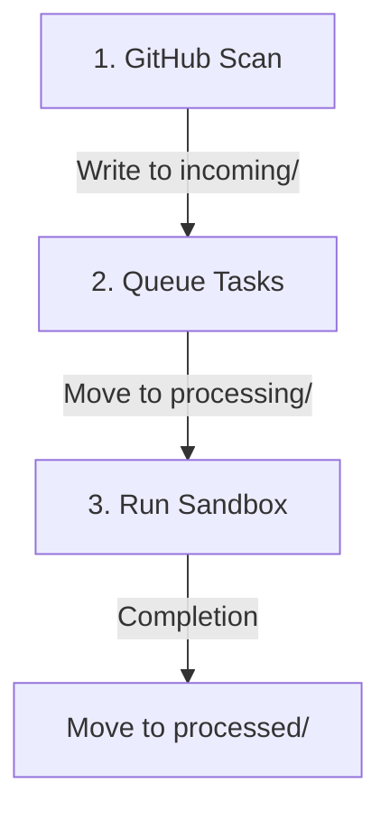

# Watch Scanning & Task Orchestration Design Reference

This document details the unified design, architecture, and behavior of the `factory watch` background loop, which serves as the core scanning and orchestration daemon of the AI Factory.

**Status:** the queue, dispatch, identity and recovery described here are current. *What* the loop decides on each issue and PR - which task, when, and when to give up - is no longer the scanners' code: since Phase 4 of [watch-rules.md](watch-rules.md) (October 2026) the rule files in `factory/pkg/watch/rules/` decide it, the scanners carry the decisions out, and the dispatcher re-decides each task just before it starts. Sections 4 and 6 say where each decision lives now; the rules themselves are described in the [watch rules guide](../docs/watch-rules.md).

---

## 1. Overview & Goals

The watch loop provides continuous monitoring of a target GitHub repository, transforming external events (issues, comments, and CI failures) into isolated coding tasks running inside cluster sandboxes.

The key goals of the watch loop design are:
* **Decoupled Scanning and Execution**: Separating event discovery (scanning) from task runs using a filesystem-based queue.
* **Smart Filtering**: Minimizing unnecessary tasks and API rate limits by skipping duplicate work (e.g., issues that already have open PRs).
* **Multi-Identity Coordination**: Automatically routing task execution to specific bot user accounts based on role mappings and ownership requirements.

---

## 2. Watch Loop Architecture

The daemon executes periodically (default: every 2 minutes) and follows a three-stage pipeline:

1. **GitHub Scan**: Fetches open issues, open PRs, comments, reviews, and CI statuses from GitHub.
2. **Queue Tasks**: Evaluates conditions, resolves assignees, and writes task yaml specs to the `incoming/` queue folder.
3. **Run Sandbox**: Reads the queue, moves the task to `processing/` atomically, runs the child `factory` CLI command, and finally moves the task and log files to `processed/`.

---

## 3. Work Item Discovery & Deduplication Rules

The watcher uses the GitHub API to discover open issues and pull requests, applying specific filters based on labels, creators, and assignees. It automatically paginates all API queries to fetch all pages of issues, PRs, reviews, and comments, bypassing default API limits.

### A. Issue Discovery (Bugs & Chores)
The watcher fetches open issues matching any of the following criteria:
1. **Assigned to Watcher**: Issues assigned to the watcher bot's login username.
2. **Labeled with Trigger Label**: Issues that have the trigger label (e.g., `factory`, `overseer`).
3. **Created by Watcher**: Open issues created by the watcher bot account itself.

*Deduplication Filters*:
* **MinNumber Filter**: Ignored if the issue or PR ID is less than the configured `minNumber` threshold.
* **PR Filter**: The watcher ignores issues that are actually Pull Requests (where `PullRequestLinks != nil`).
* **Linked PR Check**: The watcher searches all open PRs in the repository. If an open PR references the issue number in its title, description, branch name, or via the GitHub Timeline API, the issue is skipped to prevent duplicate work.

### B. Pull Request Discovery
The watcher fetches open Pull Requests matching:
1. **Assigned to Watcher**: Pull Requests assigned to the watcher bot.
2. **Labeled with Trigger Label**: Pull Requests labeled with the trigger label.
3. **Bot Pool Origin**: Only PRs created by bot accounts defined in the configured bot pool are processed. Third-party or human PRs are ignored unless they are explicitly allowlisted.

---

## 4. Task Dispatch Matrix

Once the watcher has consolidated the active issues and PRs, the rules engine decides each in its rules' order, and the scanner queues the task the deciding rule names. The task carries the rule's recipe, apply and inputs, and the dispatcher runs exactly that (`api.RecipeArgs`); the task type only names the run and picks the sandbox.

| Item Type | Rule (file) | Task Type | Spawned Command (from the rule's `run:`) | Identity Selection |
| :--- | :--- | :--- | :--- | :--- |
| **Issue** | `fix`: pointed at (trigger label, pool assignee, or opened by the watcher), no linked PR, no workflow named | `issue-rule` (`task-issue-<n>-rule-fix`) | `factory recipe fix --apply --action open-pr --pr-labels --input draft=false` | Mapped pool bot / Load-balanced coder |
| **Issue** | `workflow`: the body names a workflow definition | `agent-chore` | `factory agent create` (the `workflow` recipe) | Default fallback or mapped role |
| **PR** | `comments`: new trusted feedback | `pr-rule` (`task-pr-<n>-rule-comments`) | `factory recipe care-comments --apply --action post-replies` | Match PR author (must be in `coder` pool) |
| **PR** | `conflict`: merge conflict | `pr-rule` (`task-pr-<n>-rule-conflict`) | `factory recipe care-rebase --apply --action post-replies` | Match PR author (must be in `coder` pool) |
| **PR** | `ci`: failing checks | `pr-rule` (`task-pr-<n>-rule-ci`) | `factory recipe care-ci --apply --action post-replies` | Match PR author (must be in `coder` pool) |
| **PR** | `review`: green, wants a review (`*/review`), not reviewed at its head | `pr-rule` (`task-pr-<n>-rule-review`) | `factory recipe review --apply --action submit-review` | Random user from `reviewer` pool |

The PR rules `inherit-labels`, `inactive`, `ready` and `ready-unreview`, and every give-up, queue nothing: their writes (labels, assignees, a stop label and comment) are made by `act.ApplyWrites`.

---

## 5. Queueing & Concurrency Control

To ensure robustness, isolation, and low-latency API response times, the watcher operates through `TaskQueueManager` using thread-safe in-memory maps backed by write-through disk persistence to directory queues (`incoming/`, `processing/`, `processed/`) and append-only journal event logging (`journal.jsonl`):

1. **Scan Mode (`--mode=scan`)**: Performs GitHub and local queries, builds task specifications, and writes them atomically into `incoming/<task-id>.yaml` (ingested by the in-memory manager).
2. **Run Mode (`--mode=run`)**: Periodically drains the queue using an atomic candidate-claiming primitive (`ClaimNextCandidate`) rather than static batch snapshots:
   * **Priority Queue Scheduling**: Incoming tasks are maintained in a persistent in-memory min-heap (`TaskPriorityQueue`) ordered by priority tier (`critical` > `urgent` > `important` > `high` > `medium` > `low`), phase execution order (1 to 4), and arrival timestamp (`enqueuedAt` FIFO), eliminating the need to re-sort on every claim.
   * **Two-Phase Validation & Deferred Cycle Release**:
     - *Phase 1 (Lock Acquired)*: `ClaimNextCandidate` atomically reserves the top unblocked candidate task from `incoming/` in memory while leaving the file in `incoming/` on disk and `Status: Pending`.
     - *Phase 2 (Lock Released)*: The runner verifies external preconditions (Kubernetes sandbox pod status and GitHub stop labels/closed state) completely outside the mutex lock, then has the rules engine decide the task's rule again on the item's facts read now (`Redecide`): a gate, a moved head or a rule that no longer decides drops the task, not counted as an attempt.
     - *Resource Conflict Handling*: If the target sandbox pod is currently busy or Kubernetes is temporarily unreachable, the runner collects the candidate in a cycle-scoped list of released tasks. A deferred function in `runTasks` invokes `ReleaseTask(filename)` upon function exit to restore all skipped tasks back to the ready heap. This eliminates **Head-of-Line (HoL) blocking**, prevents intra-cycle busy-spin thrashing, and avoids unnecessary disk I/O.
     - *Permanent Pruning*: If GitHub checks reveal an issue/PR is closed or labeled with `overseer/stop`, `RemoveTask` deletes it from memory and disk.
     - *Execution Start*: Once all checks pass, `StartTask` transitions the task to `processing/` (marks `Running`, sets `StartedAt`, moves file, logs journal event) right before launching execution in the sandbox.
3. **Completion**: Once the CLI command finishes in the sandbox:
   * **Success**: The task file and output logs are moved to `processed/` with `Status: Completed`.
   * **Failure**: The task is updated with `Status: Failed` and error details, then moved to `processed/`.

---

## 6. PR Processing Event Phases & Retry Logic

The PR scanner's own phases, retry limits and circuit breakers described here before October 2026 are gone. The same behaviour is in the PR rules, in order (each rule's file says exactly when it runs and how it is paced):

* **`comments`** (queue phase 1): new feedback from a trusted human or an allowlisted review bot since the last commit and since `lastCommentAddressedTime` (or a pool bot assigned as an override). The feedback is acknowledged with 👀 when the task starts and resolved with 👍/😕 when it ends. Gives up after 3 failed runs since the head, a human or a pause.
* **`conflict`** (phase 2): the PR does not merge; once per head.
* **`ci`** (phase 3): checks failing at the head (check runs deduplicated by name, latest kept). Runs again on a new head, after a failed run, or 2h after the last. After 3 attempts since the last commit, trusted human comment or pause, it gives up: the `<trigger>/stop` label and a pause comment. Removing the label resumes it; the pause comment is the new boundary the count starts from.
* **`review`** (phase 1): opted in via `<trigger>/review` on the PR or, until it is handed to the humans, on an issue it closes; green, not approved, no new feedback, and its head not yet reviewed by the reviewer identity. The PR's and the closing issues' `## Review Instructions` are passed as instructions. It runs in a sandbox of its own (`review-<repo>-<n>`); see [pr-automated-review.md](pr-automated-review.md).

The first of these that decides to run takes the PR. The stop label (`overseer/stop`, or `<triggerLabel>/stop`) halts all processing of an item at any time: it is a gate, checked before any rule.

---

## 7. Identity & Assignee Resolution (`selectUserForTask`)

When queueing tasks, the daemon resolves which bot identity should run the task:
1. **Sandbox Pinning**: Checks if a running sandbox already exists for this task and pins the user label from that sandbox.
2. **Issue Assignees**: Inspects the issue's assignees to match any bot in the configured role pool.
3. **PR Author Mapping**: Matches the PR author against the configured role users:
   * If the PR author is in the `agent` pool, the task runs as that agent bot.
   * If the PR author is in the `coder` pool, the task runs as that coder bot.
4. **Fallback**: Falls back to the watcher daemon's own account.

---

## 8. Crash Recovery & Git Sync

* **Crash Recovery**: On watch daemon startup, any tasks found in the `processing/` directory are moved back to `incoming/`. Each task's command names its run (`--run-name`), so run again it follows the run if it is still going, applies the result of one that finished, or finds it already applied.
* **Git State Sync**: every watch cycle the Overseer image's `run.sh` fetches the repository, resets its default branch to upstream's, checks out the state branch (named after the trigger label, e.g. `overseer`) rebased onto it, runs `factory watch`, and then commits and pushes the queue (`overseer/queues`) to that branch on the fork. The pod's clone is therefore the default branch as of the cycle's start, plus the queue's commits; `spec.repoRecipe` reads the repository's recipes from its git objects (`FACTORY_REPO_RECIPE_DIR`).
