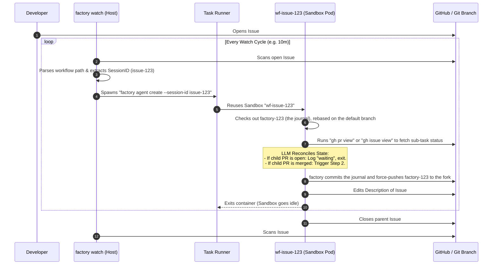

# Design Note: LLM-Driven Workflow Orchestration & Session Reconciliation

**Status:** built, and since reshaped. The reconciliation loop, `wf-issue-<n>` sandboxes, the workflow label and workflow detection (`common.FindWorkflowPath`, directory convention plus header check) are built. Changed since: conversation resume and `workflow-sessions.json` were dropped (62bf4c30: periodic runs accumulated tokens), so a workflow's state is only its journal in git; the workflow runs as the `workflow` recipe (#1914, [remove-envd.md](remove-envd.md)), not `run_agent.sh`, and keeps its journal on its own branch `factory-<n>` on the member's fork, force-pushed, not on a shared `overseer` branch, so there is no rebase-and-retry; the watch's choice is the `workflow` and `workflow-missing` rules of its rules engine (`factory/pkg/watch/rules/`, watch-rules.md); a closed linked issue nudges the workflow at once (`NudgeLinkedWorkflows`, #1691). `factory fix` and its workflow interception are gone (#1884); the CLI entry point is `factory agent create --agent <definition> --session-id issue-<n>`.

This design note outlines the architecture for persistent, multi-step workflow execution (e.g., repository migration, kind-by-kind checklist resolution) driven by LLMs, with parallel session isolation and Git/GitHub state reconciliation.

---

## Background & Problem Statement
Standard agents in `factory` are designed to execute single-shot tasks (e.g., fixing a code bug or running a chore script) and terminate, producing a Pull Request.

In contrast, a **Workflow** is a long-running, multi-step process with dependencies that spans hours or days. Examples include migrating API groups from one version to another kind-by-kind, or executing multi-stage test verifications. To support these processes:
1.  **Durable Session State**: The agent's local chat context and files must persist across pod restarts and sequential executions.
2.  **Parallel Execution**: A single repository must support multiple concurrent workflow runs of the same type (e.g., migrating `SpannerInstance` and `SpannerDatabase` in parallel).
3.  **Conflict-Free Git Pushes**: Parallel runs must commit progress logs to the `overseer` branch without fast-forward conflicts.
4.  **Reconciliation Loop**: The system must periodically wake up the agent to check the status of sub-tasks (e.g., checking if a child PR was merged) and proceed to the next step.

---

## Architecture: Reconciliation Loop & Session Mapping

Rather than keeping agent containers running continuously (wasting CPU/memory and risking connection flakes), factory implements a **reconciliation loop** modeled after Kubernetes controllers.



### Detailed Reconciliation Lifecycle Walkthrough

As first built. Today the workflow recipe takes the place of `run_agent.sh`: it checks out `factory-<n>`, runs the definition's precondition (a failure skips the step), asks once in a fresh conversation, then commits and force-pushes the branch; once the issue is closed it deletes the branch instead. The journal's path is whatever the definition tells the agent.

1.  **Trigger**: A developer opens parent issue `#123` containing a path reference to a workflow (e.g. `.agents/workflows/checklist-for-kind.yaml`) in its description.
2.  **First Run**:
    *   `factory watch` detects that issue `#123` is open and matches the workflow path, and queues a new task.
    *   The runner starts/ensures Sandbox `wf-issue-123`.
    *   The LLM runs step 1 of the workflow (e.g. it creates a child PR to add a resource).
    *   The LLM writes the current progress and tracking information into `.gemini/workflows/checklist-for-kind/session-issue-123.md`.
    *   `run_agent.sh` commits and pushes the updated journal to the `overseer` branch, maps the Gemini session ID inside the persistent registry, and exits. The Sandbox pod goes idle.
3.  **Rescheduling while Waiting**:
    *   10 minutes later (in the next watch cycle), `factory watch` runs again. Parent issue `#123` is still **open**.
    *   It checks the rate limit: has it been 10 minutes since the last run finished? Yes.
    *   It queues the task again.
    *   The runner reuses Sandbox `wf-issue-123`.
    *   `run_agent.sh` resolves `issue-123` in the mapping registry, gets the session UUID, and resumes the thread (`gemini --yolo --resume <session-id>`).
    *   The LLM checks the status of the child PR using `gh pr view <pr-num>`.
    *   If the PR is **not merged yet**, the LLM logs: *"Step 1 is still pending. I will wait."*, saves the state, pushes to the `overseer` branch, and exits. The Sandbox goes idle.
4.  **Resuming after Merge**:
    *   In a later cycle, the LLM runs `gh pr view <pr-num>` and sees that it is **merged**.
    *   The LLM logs: *"Step 1 is complete! Now executing Step 2 (creating the next issue/task)."*
    *   It performs the next step, updates the journal file, pushes to `overseer`, and exits.
5.  **Completion**:
    *   Once the entire checklist is done, the LLM closes the parent issue `#123` (`gh issue close 123`).
    *   In the next watch cycle, `factory watch` detects that issue `#123` is closed and stops queueing the task for this session.

---

## Technical Details

### 1. Distinguishing Workflows from Regular Tasks

Still the detection (`factory/pkg/commands/common/workflow.go`). The scanner records the result as an issue fact; the rules `workflow-missing` (stop with a comment when the definition cannot be loaded) and `workflow` (run the `workflow` recipe, cooldown from the definition, 10m by default) decide on it, ahead of `fix`.

To prevent every issue that references a skill or prompt from launching a persistent workflow, `factory watch` performs a two-tier verification:

1.  **Directory Convention Check**: Any path containing `/workflows/` (e.g. `.agents/workflows/checklist-for-kind.yaml`) is automatically classified as a workflow.
2.  **Content Analysis Check**: If the path does not reside in a `/workflows/` folder (e.g. it is located under `.gemini/skills/checklist-for-kind/prompt.md`):
    *   `factory watch` dynamically fetches the first 2,000 characters of the referenced file from GitHub using the Repository GetContents API.
    *   It scans the file header/front-matter for workflow keywords: `mode: workflow`, `mode: "workflow"`, or `AGENT_MODE=workflow`.
    *   If found, it is classified as a workflow.
3.  **Fallback**: If neither condition is met, the path is assumed to be a standard task prompt, and the issue is queued as the fix rule's task (`issue-rule`, `task-issue-<n>-rule-fix.yaml`).

### 2. Session Isolation & Sandbox Naming

To avoid long names that exceed Kubernetes' 63-character limit:
*   **Sandbox Name**: When `SessionID` matches `issue-<num>`, the sandbox is named `wf-issue-<num>`.
*   **Sandbox Label**: We inject a label `factory.gemini.google.com/workflow: <workflow-name>` (e.g., `checklist-for-kind`) on the Sandbox CR to keep track of the workflow type.

### 3. Dynamic Gemini Session Mapping

Removed (62bf4c30): every run starts a fresh conversation, and the journal carries the state.

Gemini session files are named dynamically with UUIDs in the persistent home directory (`/workspaces/.home/.gemini/tmp/`). To resume the same thread across sequential reconciliation runs:
1.  We maintain a local JSON registry inside the persistent volume: `$HOME/.gemini/workflow-sessions.json`.
2.  Before running Gemini, the script `run_agent.sh` checks:
    ```bash
    INTERNAL_ID=$(jq -r --arg sid "$SESSION_ID" '.[$sid] // ""' "$MAPPING_FILE")
    ```
    If an internal ID exists, it resumes the thread using `gemini --yolo --resume $INTERNAL_ID`.
3.  On task completion, if a new session was started, the script writes the mapping back:
    ```bash
    jq --arg sid "$SESSION_ID" --arg iid "$INTERNAL_ID" '.[$sid] = $iid' "$MAPPING_FILE"
    ```

### 4. Git Push Conflict Mitigation (Rebase-and-Retry)

Superseded: each workflow has its own branch, `factory-<n>`, which only it writes, so there is nothing to rebase or retry.

When parallel sessions commit their logs to the `overseer` branch, they push to the same remote. To prevent push failures:
1.  **Disjoint Files**: Sessions write to unique journal files named after their issue ID (e.g., `session-issue-123.md`), making Git merges automatic.
2.  **Rebase-and-Retry Loop**: When pushing changes, `run_agent.sh` executes a loop that pulls with rebase, rebases local commits, and pushes, with randomized backoff:
    ```bash
    while [ $RETRY_COUNT -lt 5 ]; do
        if git pull --rebase origin overseer && git push origin overseer; then
            break
        fi
        sleep $((RANDOM % 5 + 2))
    done
    ```

### 5. Hybrid State Syncing for Developer Visibility

To keep developers informed of the workflow's current state:
1.  **Authoritative State**: Stored in Git in session-specific Markdown journals (e.g. `.gemini/workflows/checklist-for-kind/session-issue-123.md`).
2.  **Visual Progress State**: The agent uses the `gh` CLI to dynamically edit the description/body of the triggering GitHub issue (e.g., `#123`). The agent keeps a markdown checklist updated, showing completed sub-tasks, pending steps, and active PR links.

### 6. Unified Developer CLI UX

Removed with `factory fix` (#1884). A workflow is run by the watch's `workflow` rule, or by hand with `factory agent create --url <issue> --agent <definition> --session-id issue-<n>`.

To keep the developer interface simple and prevent confusion between `fix`, `agent`, and `workflow` commands, we unify the entry point under the existing `factory fix` command:

*   **Usage**: The developer simply runs:
    ```bash
    factory fix --url https://github.com/owner/repo/issues/123
    ```
*   **Automatic Interception**: Under the hood, `factory fix` fetches the target GitHub issue.
    *   It parses the issue description for workflow definitions (using the same content analysis & directory convention logic).
    *   If a workflow reference is identified, `factory fix` automatically forwards the task execution to `RunAgent` in **workflow mode** (passing `SessionID: issue-123`).
    *   If no workflow is identified, it executes standard single-shot **code-fix mode**.
*   This hides the underlying orchestration complexity from the developer while providing the correct runtime environment automatically.

